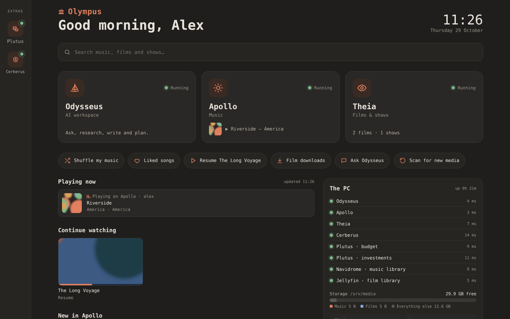
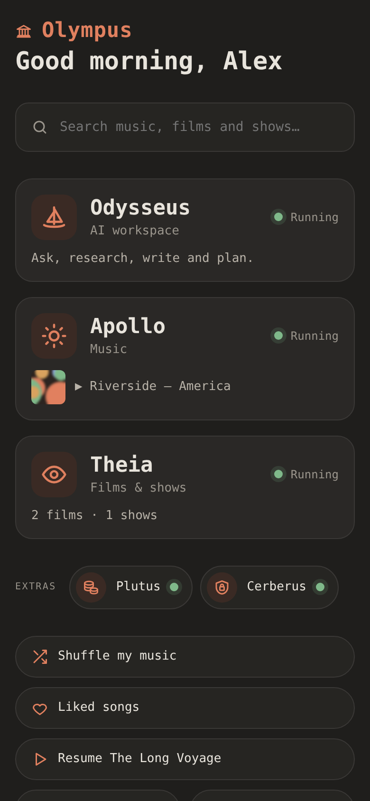

# Olympus

**One home screen for your home lab.**
A dark, phone-friendly dashboard that sits in front of your self-hosted apps. It shows what's running, what's playing, how much space is left and whether last night's backup worked, and it sends alerts to your phone when something goes wrong.



| On a phone |
| --- |
|  |

## The Olympus home lab

Olympus is the front door. Each app lives in its own repo and installs with one line. Install the ones you want; Olympus picks up whichever are running.

| | App | What it does | Runs on | Phone port |
| --- | --- | --- | --- | --- |
| 🏛 | **Olympus** (this repo) | Home screen, status, alerts, nightly backups | Python | 9443 |
| ☀️ | **[Apollo](https://github.com/Mrmoody1/apollo)** | Your own Spotify for the music you own | [Navidrome](https://www.navidrome.org) | 443 |
| 👁 | **[Theia](https://github.com/Mrmoody1/theia)** | Films & shows, offline downloads, cast, watch together | [Jellyfin](https://jellyfin.org) | 8443 |
| 💰 | **[Plutus](https://github.com/Mrmoody1/plutus)** | Budget, investments, Trading 212 sync | [Actual](https://actualbudget.org) + [Ghostfolio](https://ghostfol.io) | 5443 / 3443 |
| 🛡 | **[Cerberus](https://github.com/Mrmoody1/cerberus)** | Password manager for the Bitwarden apps | [Vaultwarden](https://github.com/dani-garcia/vaultwarden) | 7443 |

**Install everything** (pick and choose — each line is independent):

```bash
curl -fsSL https://raw.githubusercontent.com/Mrmoody1/olympus/main/get.sh  | bash   # Olympus (+ backups in backup/)
curl -fsSL https://raw.githubusercontent.com/Mrmoody1/apollo/main/get.sh   | bash   # music
curl -fsSL https://raw.githubusercontent.com/Mrmoody1/theia/main/get.sh    | bash   # films & shows
curl -fsSL https://raw.githubusercontent.com/Mrmoody1/plutus/main/get.sh   | bash   # money
curl -fsSL https://raw.githubusercontent.com/Mrmoody1/cerberus/main/get.sh | bash   # passwords
```

**Rebuilding from scratch** (new PC or a dead one): install [Tailscale](https://tailscale.com) and Docker, run the lines above, then put your data back from the nightly backup — see [Backups](#backups-backup).

## What's on it

- **Three main tiles:** Odysseus (AI workspace), [Apollo](https://github.com/Mrmoody1/apollo) (music) and [Theia](https://github.com/Mrmoody1/theia) (films and shows), each with a live status light.
- **Extras rail:** a slim rail of smaller apps down the left, or a row of pills on a phone:
  - **[Plutus](https://github.com/Mrmoody1/plutus):** budget, investments, and a quick *Update balances* screen.
  - **[Cerberus](https://github.com/Mrmoody1/cerberus):** passwords.
- **Search** across your music, films and shows at once.
- **Live bits:**
  - What's playing in Apollo.
  - Continue watching from Theia.
  - What's new in each.
- **Quick actions:** shuffle your music, liked songs, resume the last film, scan for new media.
- **The PC panel:**
  - Every service with its response time.
  - Storage split into music, films and everything else.
  - CPU, memory and graphics card load and temperature.
  - Phone alerts.
  - Backups.
- **Phone alerts** through [ntfy](https://ntfy.sh):
  - The PC turning on.
  - An app going down or coming back.
  - Storage below 8%.
  - The monthly Plutus balance reminder.
- **Installable app** on your phone, with its own icon.

## Install

On **Ubuntu, Debian or Linux Mint**:

```bash
curl -fsSL https://raw.githubusercontent.com/Mrmoody1/olympus/main/get.sh | bash
```

This downloads Olympus into `~/olympus` and sets it up to start with the computer, on port **8097** or the next free one. Open **http://localhost:8097** and sign in with your Navidrome or Jellyfin account.

If the repo is private, use `git clone https://github.com/Mrmoody1/olympus ~/olympus && ~/olympus/install.sh` instead.

### Options

| Variable | Default | What it does |
| --- | --- | --- |
| `OLYMPUS_PORT` | 8097 | The port Olympus uses. A reinstall keeps the existing one. |
| `NAVIDROME_URL` / `JELLYFIN_URL` | `http://127.0.0.1:4533` / `:8096` | Where your music and film libraries are. |
| `ODYSSEUS_URL` / `APOLLO_URL` / `THEIA_URL` | `:7011` / `:8090` / `:8095` | Where each app is. |
| `NTFY_URL` / `NTFY_TOPIC` / `NTFY_TOKEN` | `http://127.0.0.1:8091` / `olympus` / none | Phone alerts. A reinstall keeps the existing topic. |

For example: `NTFY_TOPIC=HomeLab ./install.sh`

## On your phone, from anywhere

Over [Tailscale](https://tailscale.com):

```bash
sudo tailscale serve --bg --https=9443 8097
```

Open `https://<your-pc>.<tailnet>.ts.net:9443`, then tap **⋮** → **Install app**.

Olympus expects the other apps on their usual Tailscale ports:

| App | Port |
| --- | --- |
| Apollo | 443 |
| Theia | 8443 |
| Odysseus | 10000 |
| Cerberus | 7443 |
| Plutus Budget | 5443 |
| Plutus Investments | 3443 |

## Backups (`backup/`)

`backup/homelab-backup-setup.sh` sets up nightly encrypted backups with [restic](https://restic.net). They go to a local drive mounted at `/mnt/backup`, and optionally offsite to [Koofr](https://koofr.eu) (free 10 GB) through [rclone](https://rclone.org).

```bash
bash ~/olympus/backup/homelab-backup-setup.sh
```

**What it does:**
- **When it runs:** every night at 3am, or soon after start-up if the PC was off.
- **App databases** are copied safely. Navidrome, Jellyfin, Odysseus, Cerberus and Plutus each pause for a few seconds, or have their database dumped while they run.
- **Keeps** 7 daily, 4 weekly and 6 monthly backups, and checks a sample for damage on the 1st of each month.
- **Reports** to Olympus's Backups panel and to your phone.
- **The backup password** is shown once, at the end. **Write it down**: without it, the backups can't be opened.

**Commands:**

| Command | What it does |
| --- | --- |
| `homelab-backup` | Back up now |
| `homelab-backup list` | List the backups |
| `homelab-backup test` | Test a restore |
| `homelab-backup check` | Check for damage |
| `homelab-backup restore hdd /srv/media/music` | Put that folder back in `/tmp/restore` |

## Update

Run the install command again. Your settings are kept.

## Uninstall

```bash
~/olympus/uninstall.sh
```

This removes the Olympus service. Your apps, data and backups are left alone.

## Handy commands

```bash
systemctl status olympus
sudo systemctl restart olympus
journalctl -u olympus -n 30 --no-pager
```

## How it works

`server.py` is a small Python program with no dependencies:
- It serves the page from `web/` and passes `/nav/` and `/jf/` requests through to Navidrome and Jellyfin.
- It checks each app every minute and reads system stats.
- It sends the ntfy alerts.

The Plutus balance screen saves to Ghostfolio through its API. It only accepts changes made on the PC itself or over Tailscale, and only for the accounts listed in `plutus.json`.

## Licence

MIT. See [LICENSE](LICENSE).
